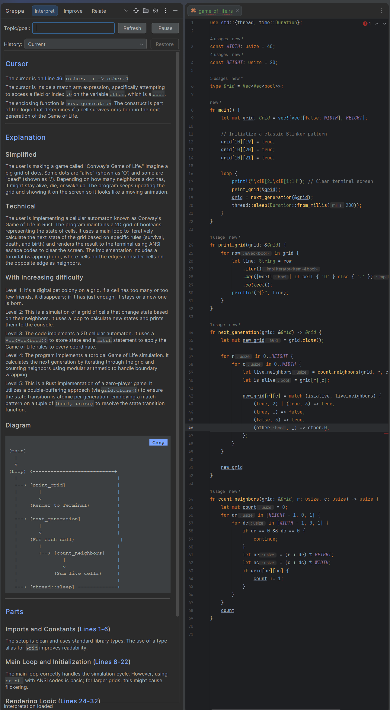
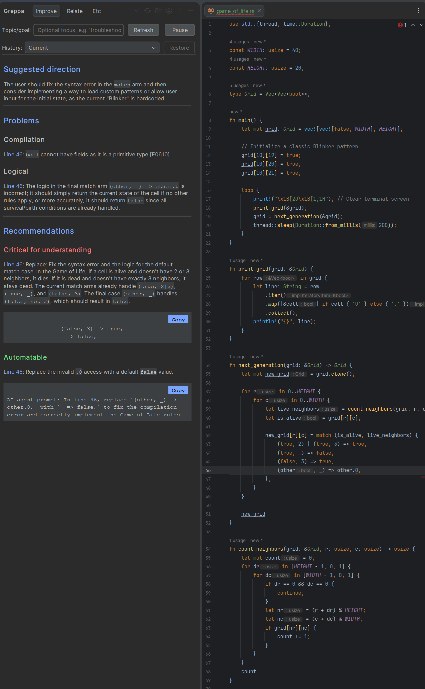
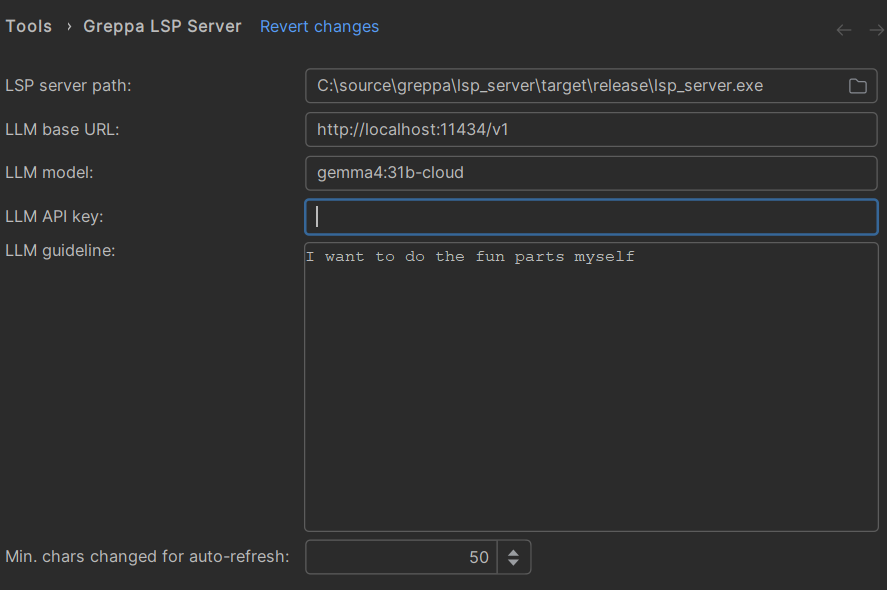

# Greppa

**Greppa** is a JetBrains plugin for long-term software projects, where progress depends on the developer’s understanding of their own code. AI-assisted coding speeds up prototyping and implementation, but it can also leave developers less familiar with what has been written. Because AI agents tend to take a lot of initiative, keeping the agent, the software, and the developer’s intent aligned can become a challenge.

Instead of handing control to an agent that edits the code, Greppa automatically **identifies tasks that you should do yourself**, while leaving the rest to an agent. For manual tasks, the plugin acts more like a soft-assist, guiding the developer, as opposed to an agentic harness.
The AI follows along as the developer works: it analyzes their changes, gives feedback, and can auto-complete parts the developer hasn’t considered.

## Features

### Interpret view
* Grasp code quickly: an LLM interprets your code and generates a clear, informative markdown summary
* Get explanations of varying difficulty (level 1-5) to match your current level
* Automatically generated diagrams that visualizes what the code does
* Receive explanations focused on the code under your cursor
* Navigate with ease: files are broken into explained segments, each linked to its source code by a blue line you can click

### Improve view
* Sorts tasks into "Critical for understanding" and "Automatable", guided by your own configurable guidelines
* Identifies both compilation and logical errors, immediately explaining them and suggesting a course correction  

### Topic/goal
* Optionally set a topic or goal to focus on; it shapes most or all generated content

### JetBrains integration
* Auto-complete code based on the generated markdown
* Get "code action" suggestions

### Configuration

* **LLM base URL:** the endpoint of your OpenAI-compatible provider
* **LLM model:** the name of the model to use
* **LLM API key:** optional, if your provider requires one
* **LLM guideline:** an optional, personal guideline that steers how the LLM responds; it is simply added to the prompt

### Compatibility
* Works with any OpenAI-compatible provider (see the [OpenAI OpenAPI specification](https://github.com/openai/openai-openapi)). See the Ollama example configuration below.

## Note

* This plugin is only as good as the LLM you use, I recommend using a model with ~30b+ parameters. Your mileage may vary.

## Screenshots

### Interpret view

### Improve view:

### Settings view

## Reservations

* This project was vibe-coded and I take no credit for it.